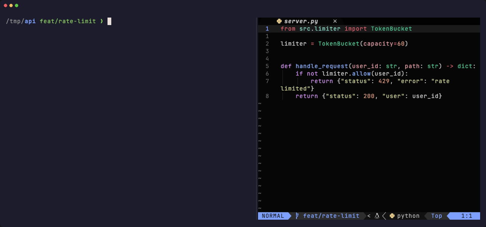

# git-pretend

Review your PR in the editor you already use — any range of commits, as if you had just written it yourself.



```sh
git pretend main...      # your branch, as its pull request would show it
# ...read it with whatever you like: git diff, your editor, lazygit, tests, an agent...
git pretend done         # back where you were
```

While pretending, `HEAD` is detached at the older commit and the working tree holds the newer
commit's files as **uncommitted changes**. Every tool that understands "my changes" now works on
that range, without needing to know anything about ranges:

- `git status`, `git diff` and `git add -p` show the range
- gitsigns, vim-gitgutter and the VS Code / JetBrains gutters mark every changed line
- lazygit, tig and GitHub Desktop list the changes as your working copy
- LSP, grep, linters and the test suite run against the newer code, which is what is on disk
- coding agents asked to "review my changes" review the range

Diff viewers can show you a range, but only this way does the rest of your tooling see it too.
It refuses dirty working trees, saves any edits made while pretending as a patch on `done`, and
never deletes untracked files.

## Usage

```
git pretend <commit>              pretend you wrote <commit> (diff against its parent)
git pretend <old> <new>           pretend you wrote everything from <old> to <new>
git pretend <old>..<new>          same, range syntax (an empty side means HEAD)
git pretend <base>...<new>        from the merge base, like a pull request
git pretend [pick [<log args>]]   choose commits with fzf
git pretend status [--short|--porcelain]
                                  show what you are pretending (exit 1 if nothing)
git pretend done                  discard the pretend changes and go back
```

A few common ones:

```sh
git pretend HEAD             # the last commit
git pretend HEAD~3 HEAD      # the last three commits, as one change
git pretend main...          # this branch since it left main (what its PR would show)
git pretend origin/main...origin/feature   # someone else's branch, without checking it out first
```

Pretending is for reading. `git pretend done` throws away anything you changed in the meantime,
after saving it as a patch in `.git/pretend-discarded/` (`git apply` it to get the edits back).
Untracked files you create are never deleted, only listed.

### Picking commits with fzf

Run `git pretend` with no arguments (or `git pretend pick`) and, if [fzf] is installed, you get
a picker over `git log` with a preview of each commit:

- <kbd>Enter</kbd> on a commit pretends you wrote that commit
- <kbd>Tab</kbd> two commits, then <kbd>Enter</kbd>, pretends you wrote everything between them
  (in either order: the older one is worked out for you)

Anything after `pick` goes to `git log`, so you can narrow the list down or widen it:

```sh
git pretend pick --all               # commits from every branch
git pretend pick main..              # only this branch's commits
git pretend pick --author=sam -- src # someone's commits that touch src/
```

fzf is optional: without it, pass commits as arguments.

[fzf]: https://github.com/junegunn/fzf

### lazygit

lazygit already has a commit list with range selection, so it makes a good picker too. Add to
your lazygit `config.yml`:

```yaml
customCommands:
  - key: X # any key that is free in the commits panel
    context: commits
    description: Pretend I wrote the selected commits
    # One commit, or a range selected with v: From is the oldest, To the newest
    command: git pretend {{.SelectedCommitRange.From}}^ {{.SelectedCommitRange.To}}
    output: log
  - key: X
    context: files
    description: Stop pretending
    command: git pretend done
    output: log
```

### Editors

- Neovim: [pretend.nvim](https://github.com/alex-k03/pretend.nvim) adds a commit picker,
  `:Pretend`, statusline helpers, and reloads buffers when you start and stop.

Anything else can shell out to `git pretend` and read `git pretend status --porcelain`.

### Shell prompt

While pretending, `HEAD` is detached, so most prompts swap your branch for a commit hash, which
looks like an ordinary detached checkout. `git pretend status --short` prints the branch you will
go back to (or the commit, if you started detached) and exits 1 when you are not pretending,
which is all a prompt needs to show the branch as usual plus a marker. With [starship]:

```toml
# In your format, replace $git_commit with ${custom.pretend}${custom.git_commit}
# (and set only_attached = true under [git_branch] if your prompt shows HEAD)
[custom.pretend]
description = "git-pretend is on: the branch you will go back to"
require_repo = true
# A cheap check, so git-pretend itself only runs while pretending
when = '[ -f "$(git rev-parse --absolute-git-dir 2>/dev/null)/pretend/state" ]'
command = "git pretend status --short"
shell = ["sh"]
format = "[$output](green) [pretend](bold purple) "

# The built-in git_commit can't be hidden while pretending, so this stands in for it: the hash
# (and tag) when HEAD is detached and git-pretend is off
[custom.git_commit]
require_repo = true
when = '! git symbolic-ref -q HEAD >/dev/null && [ ! -f "$(git rev-parse --absolute-git-dir)/pretend/state" ]'
command = """
printf '%s' "$(git rev-parse --short=8 HEAD)"
if tag=$(git describe --tags --exact-match HEAD 2>/dev/null); then printf ' #%s' "$tag"; fi
"""
shell = ["sh"]
format = "[$output](green) "
```

which shows `…/repo my-feature pretend !12 ❯` while pretending and `…/repo my-feature ❯`
otherwise. For any other prompt the idea is the same: if
`$(git rev-parse --absolute-git-dir)/pretend/state` exists, show `git pretend status --short`
where the branch goes.

[starship]: https://starship.rs

## How it works

`git pretend <old> <new>` refuses to start if you have uncommitted changes to tracked files, or
a merge, rebase, cherry-pick or bisect in progress. Then it:

1. records where you are (your branch, or the commit if `HEAD` was detached) and which files are
   untracked, in `.git/pretend/`
2. `git switch --detach <new>` puts the newer files on disk
3. `git reset <old>` moves `HEAD` and the index back, leaving those files as unstaged changes
4. `git add --intent-to-add` on files added in the range, so they show as new files in diffs
   rather than as untracked

`git pretend done` saves `git diff <new>` (your edits, if any) as a patch, runs
`git reset --hard <new>`, switches back to where you were and lists any untracked files that
appeared.

If `HEAD` was moved while pretending (you switched branch, say), `done` notices, clears its
state and touches nothing: resetting then could wipe that branch's work. Commits made while
pretending are reported with the command to keep them.

The state lives in the git dir of the current worktree, so pretending survives closing your
shell or editor, and each `git worktree` can pretend independently.

### Things to know

- Git hooks run as for any checkout: `post-checkout` runs on the way in and on the way out.
- Submodules are not updated to the newer commit.
- Ignored files (build output, `node_modules`, ...) stay as they are, so they may be out of date
  for the newer code.
- If your shell is in a directory that does not exist in the newer commit, `cd` out of it.
- `git pretend --help` opens the man page, which needs `make install` (or Homebrew);
  `git pretend -h` always works.

## Install

It is one POSIX shell script that only needs git (and optionally fzf). Put `git-pretend`
anywhere on your `PATH` and `git pretend` works.

**Homebrew** (macOS and Linux): **not available yet**, the tap is coming soon. Use curl or a
clone below for now.

```sh
brew install alex-k03/tap/git-pretend  # NOT AVAILABLE YET: the tap doesn't exist, this fails for now
```

**curl**, the latest release into `~/.local/bin`:

```sh
curl -fsSL -o ~/.local/bin/git-pretend https://github.com/alex-k03/git-pretend/releases/latest/download/git-pretend
chmod +x ~/.local/bin/git-pretend
```

**From a clone**, with the man page:

```sh
git clone https://github.com/alex-k03/git-pretend
cd git-pretend && make install   # PREFIX=~/.local by default
```

## Development

```sh
make test    # runs test/run.sh under every shell it can find (sh, dash, bash, zsh)
make lint    # shellcheck
```

## License

MIT
